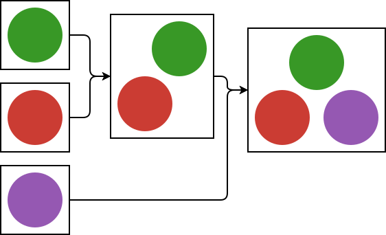

# AssemblyTheory.jl



An extensible Julia package for assembly optimisation and stochastic simulation,
built around shared system interfaces and specialised solvers.

**Early development:** the package provides configurable directed strings, a tiny
integer-addition demonstration, explicit constructions, and feasibility verification.
Optimisation solvers and simulation engines are planned, not implemented.

## Implemented

- Ordered string building blocks, derived or explicit character alphabets, and
  exact string equality. `DirectedStringSystem()` preserves the `["L", "U"]` default.
- Separate rules for unrestricted concatenation, higher L count on the left, or
  higher L proportion on the left. Ties permit both distinct orders; proportion
  comparisons are exact. These restrict products, not sampling probabilities.
- Generic constructions with explicit parent references and reusable intermediates.
- Object, parent, and ancestor inspection for one or multiple target references,
  including primitives and earlier outputs.
- Verification of object validity, operand availability, and assembly rules.
- Positive integer addition using the same certificates and verifier; no chain search.

The small multiple-dispatch interface separates building blocks, assembly rules,
validity constraints, and equality from construction verification. A verified
construction certifies feasibility; it does not establish a minimum step count.

```julia
using AssemblyTheory

system = DirectedStringSystem(["L", "U"]; rule=HigherLProportion())
construction = Construction([
    AssemblyStep(1, 2, "LU"),   # Ref 3; refs 1 and 2 are the ordered primitives.
    AssemblyStep(3, 3, "LULU"), # Ref 4; using a reference twice is allowed.
])
verify(system, construction)                         # true
reference_object(system, construction, 4)             # "LULU"
parent_references(system, construction, 4)            # (3, 3)
ancestor_steps(system, construction, [1, 3, 4])        # [1, 2] (step indices)
```

A construction is interpreted relative to the system's **ordered building
blocks**; changing that order changes the references. Blocks are never silently
sorted or deduplicated. The alphabet is derived from block characters unless
specified explicitly, for example `DirectedStringSystem(["LL"]; alphabet="LU")`.
Here `L` and `U` are valid objects but neither is an available primitive.

Parent references preserve construction history. Equal objects produced by
different steps remain separate references, and repeated parents remain visible.
Ancestor inspection includes each selected target's producing step and shared
ancestors once; it does not merge equal objects or prove feasibility.

## Planned

Optimisation and addition-chain search, assembly index and depth objectives,
discrete Dirichlet energy, joint assembly / COJAS, stochastic dynamics, external
solver adapters, further object types, and graph attachment machinery are future work.
See [the roadmap](docs/roadmap.md) and
[mathematical conventions](docs/mathematical_conventions.md).

## Local use

Requires Julia 1.10 or later. From the repository root:

```sh
julia --project=. -e 'using Pkg; Pkg.instantiate()'
julia --project=. -e 'using Pkg; Pkg.test()'
julia --project=. examples/string_concatenation.jl
julia --project=. examples/integer_addition.jl
```

To install this local checkout into a separate Julia environment, run
`using Pkg; Pkg.develop(path="/absolute/path/to/AssemblyTheory.jl")` in that
environment's Julia REPL. The package has no runtime dependencies.

See [CONTRIBUTING.md](CONTRIBUTING.md) for development guidance. Distributed
under the existing [MIT license](LICENSE).
